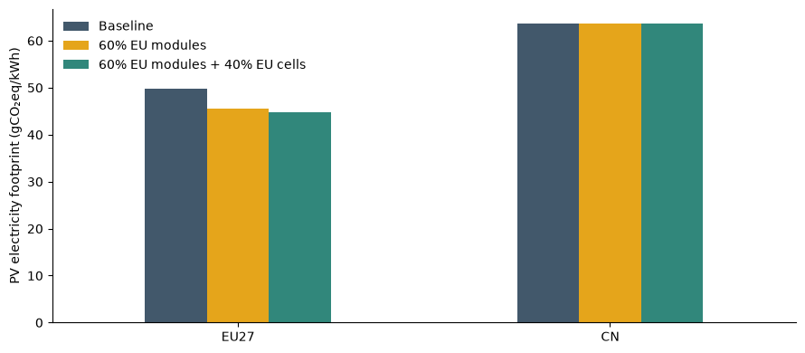

# PV-HLCA

**A hybrid input-output model of the photovoltaic supply chain, built with MARIO.**

Explore how PV technology, manufacturing locations and electricity systems affect
the carbon footprint and producer price of solar electricity, production, value
added and employment across 22 world regions.

| Use the model | Reproduce the paper |
|---|---|
| Change technology parameters, define scenarios and compare results. | Access the archived study, its assumptions, sensitivity analysis and figures. |
| [Get started](docs/use-the-model.md) · [Example notebook](notebooks/Use_the_model.ipynb) | [Reproduction guide](paper/README.md) · [Published archive](https://doi.org/10.5281/zenodo.20734983) |

## Run your first experiment

From a checkout of this repository, create a dedicated Python 3.12 environment:

```bash
conda env create -f environment.yml
conda activate pv_hlca
python tools/install.py
```

```bash
pv-hlca check examples/eu_reshoring.yaml
pv-hlca run examples/eu_reshoring.yaml
```

The first run automatically obtains any missing source database from the fixed
[Zenodo record 18744457](https://doi.org/10.5281/zenodo.18744457): **1.78 GB**,
with resumable downloads, published-checksum verification and automatic TXT-to-Parquet
conversion. It then prepares `models/prepared/`. Later experiments reuse that verified
bundle, so you can focus on parameters and scenarios. A prepared bundle can also
be shared with collaborators who use the same code version; they can run it
without the original large database. Existing complete local source files are
reused. Use `pv-hlca download` to fetch the source separately, or `--offline` to
prevent downloads. [Installation and data instructions](docs/installation.md) ·
[How preparation works](docs/database-preparation.md).

Results go to `outputs/eu_reshoring/`: six CSV tables plus the experiment definition
and a run manifest. The commercial baseline is included in each comparison.
Use a new `--output` directory for each experiment.

## What can I change?

| Technology assumptions | Scenario choices |
|---|---|
| Regional capacity-factor source: OWID or Renewables Ninja | PV sourcing by importing region, supply-chain stage and supplier |
| Module efficiency | Domestic sourcing shares, preserving the remaining foreign shares |
| Annual degradation | Custom regional electricity mixes and separate household-demand additions |
| Upstream electricity inventory: IEA PVPS or NREL | Reference presets: baseline, domestic, NZIA and baseline 2030 |

Copy an [example YAML](examples/eu_reshoring.yaml), edit the values and run it.
The [parameter guide](docs/parameters.md) explains what each change means; the
[scenario guide](docs/scenarios.md) explains what is held constant and how presets
can be extended. These controls operate within the model's existing crystalline-silicon
PV supply-chain representation and regional aggregation.



Example generated by the worked notebook: 22% module efficiency, 0.5% annual
degradation, and two changes to EU sourcing under the same technology assumptions.

## Work in Python

```python
from pv_hlca import PVModel, ModelParameters, Scenario

model = PVModel.load("models/prepared", ModelParameters(module_efficiency=0.22))
model.add_scenario(Scenario(
    "eu_modules_60",
    domestic_shares={"EU27": {"PV modules": 0.60}},
))
footprints = model.results()["footprints"]
comparison = footprints.pivot(index="region", columns="scenario", values="footprint_gkwh")

db = model.db  # the underlying MARIO Database, available for further analysis
```

Start with the [worked notebook](notebooks/Use_the_model.ipynb) or consult the
[Python API](docs/api.md). Preparation is documented separately, including the
aggregation, sector insertion, source data and MARIO compatibility assumptions.

## Research reference

The model was used in Rinaldi et al. (2026),
[*Environmental and socio-economic implications of solar photovoltaic reshoring under
the EU Net Zero Industry Act: a hybrid input–output assessment*](https://doi.org/10.1007/s44498-026-00175-0).

The study's archived code and results remain at
[Zenodo 20734983, version 1.0.1](https://doi.org/10.5281/zenodo.20734983).
The [reproduction guide](paper/README.md) distinguishes that published snapshot,
the current reusable model and comparison with the older thesis reference data.
See [executed checks and numerical agreement](docs/verification.md).
